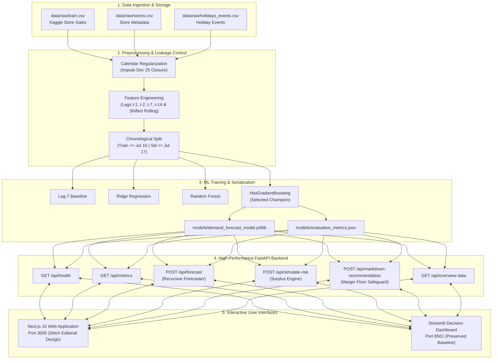

# FreshTrack Intelligence: AI-Based Retail Food Waste Prediction and Dynamic Markdown Recommendation System

---

## Academic Front Matter

**Symbiosis Institute of Technology, Pune**  
*(Constituent of Symbiosis International Deemed University, Pune)*  
**Department:** Department of Artificial Intelligence and Machine Learning (AIML)  
**Course Name:** Applications and Use Cases of Machine Learning (AUCML)  
**Course Code:** TE7483  
**Academic Year / Semester:** Third Year, Semester 5 (Batch: 2024–2028)  
**Assessment Type:** End Semester Examination (ESE) — Case Study Project Evaluation  
**Assessment Weightage:** 30 Marks (60% Weightage) — Course Outcomes: CO1, CO2, CO3, CO4  

**Faculty Evaluators:**  
- Dr. Aniket Shahade  
- Dr. Shrikrishna Kolhar  
- Dr. Sumanto Dutta  

**Student Submitter Details:**  
- **Student Name:** `[Student Name Placeholder]`  
- **Permanent Registration Number (PRN):** `[PRN Placeholder]`  
- **Roll Number:** `[Roll Number Placeholder]`  
- **Date of Submission:** `[Date Placeholder, e.g., October 2026]`  

---

## 1. Executive Summary & Abstract

Retail grocery operations face an intrinsic economic and environmental dilemma in managing perishable food inventory. Traditional supermarket inventory management relies on static buffer reordering and manual, reactive end-of-day markdowns, resulting in severe commercial shrinkage, landfill disposal, and food waste. 

**FreshTrack Intelligence** addresses this challenge through a decision-support platform that couples:
1. **Supervised Demand Forecasting:** Autoregressive time-series forecasting across 9 perishable grocery categories using empirical retail transactions from Corporación Favorita (Kaggle Store Sales benchmark, Store 1 in Quito, Pichincha, Ecuador).
2. **Perishable Waste Risk Quantification:** A recursive multi-step forecasting engine that quantifies projected surplus units ($W_i$) across dynamic shelf-life horizons without future data leakage.
3. **Margin-Safe Dynamic Markdown Recommendation:** A rule-based pricing tier engine ($0\%, 15\%, 30\%, 50\%$) that accelerates inventory velocity while enforcing a strict mathematical minimum-margin cost floor ($\text{Price} \ge \text{Unit Cost} \times (1 + \text{Margin Floor})$).
4. **Dual Production Interfaces:** A modern Next.js 16 web application and a multi-tab Streamlit application connected to a high-performance Python FastAPI backend.

Across an empirical 30-day chronological holdout partition ($N = 270$ samples, July 17 to August 15, 2017), a comparative tournament was conducted across four candidate architectures: Lag-7 Heuristic Baseline ($14.56\%$ WAPE), Ridge Regression ($13.08\%$ WAPE), Random Forest Regressor ($11.29\%$ WAPE), and **Histogram-based Gradient Boosting Regressor** (`HistGradientBoostingRegressor`). The champion model achieved a **Weighted Absolute Percentage Error (WAPE) of $10.69\%$**, a **Mean Absolute Error (MAE) of $50.9129$ units**, a **Root Mean Squared Error (RMSE) of $103.8764$ units**, and an overall **pooled $R^2$ of $0.9805$** ($0.7916$ volume-weighted within-family $R^2$, and $0.5749$ unweighted macro-averaged $R^2$).

The end-to-end system is verified through 47 automated Pytest unit and integration tests and 54 Playwright browser acceptance tests across 6 responsive viewports (360px to 1440px), operating with zero temporal leakage.

---

## 2. Problem Statement, Objectives, Scope, and Stakeholders

### 2.1 The Retail Perishable Inventory Trade-off
Supermarket category managers operate under high stochastic uncertainty when stocking short shelf-life perishable food items (e.g., fresh produce, meats, dairy, poultry, seafood, deli, and bakery). The inventory dilemma is governed by two asymmetric operational risks:
- **Under-Stocking (Stockout Penalty):** Leads to immediate lost revenue, negative brand perception, and basket abandonment.
- **Over-Stocking (Spoilage & Shrink Penalty):** Leads to unsold stock reaching expiration dates. In commercial grocery retail, expired perishables cannot legally be sold, resulting in biological waste, landfill emissions, and write-offs.

Traditional supermarket markdowns are reactive, arbitrary, and manual: store clerks inspect shelves hours before closing and apply subjective stickers (e.g., "30% off"), often breaching wholesale procurement margins or discounting too late to stimulate demand.

### 2.2 Project Objectives
1. **Develop an Accurate Category-Level Demand Forecaster:** Predict daily sales volumes for 9 perishable grocery families using calendar exogenous variables, promotion schedules, and autoregressive lag indicators.
2. **Formulate a Leakage-Safe Recursive Multi-Step Horizon Predictor:** Project daily demand curves over variable remaining shelf-life horizons ($T_{\text{shelf}} \in [1, 30]$ days) without leaking future ground-truth observations.
3. **Quantify Pre-Expiry Waste Surplus Risk:** Estimate expected unsold surplus units and categorize inventory into standardized operational risk tiers (`LOW`, `MODERATE`, `HIGH`, `CRITICAL`).
4. **Implement an Explainable Dynamic Markdown Decision Engine:** Map risk tiers to progressive discount recommendations while enforcing an automated cost-floor safeguard to protect retail unit economics.
5. **Deploy an Interactive Dual-Interface Decision Support System:** Deliver actionable insights to store operators via responsive web dashboards.

### 2.3 Scope and Operational Boundaries
- **Geographic and Store Scope:** Store 1, an established urban supermarket operated by Corporación Favorita in Quito, Pichincha Province, Ecuador.
- **Product Scope:** 9 perishable grocery product families: `BREAD/BAKERY`, `DAIRY`, `DELI`, `EGGS`, `MEATS`, `POULTRY`, `PREPARED FOODS`, `PRODUCE`, and `SEAFOOD`.
- **Temporal Horizon:** Training partition spanning January 15, 2016 through July 16, 2017 ($549$ dates, $4,941$ rows); chronological validation holdout partition spanning July 17, 2017 through August 15, 2017 ($30$ dates, $270$ rows).
- **Academic Disclaimer on Boundaries:** The project uses empirical point-of-sale sales data. Public supermarket datasets do not record live warehouse RFID telemetry, physical batch expiry dates, wholesale procurement costs, or verified price elasticity curves. Consequently, starting inventory, shelf-life days, procurement unit costs, and customer markdown uplift are modeled as user-configurable simulation parameters.

### 2.4 Stakeholder Mapping
- **Store General Managers:** Seek aggregate daily perishable shrink reduction and floor operations oversight.
- **Category Inventory Planners:** Require accurate multi-day demand projections to adjust replenishment orders and minimize over-ordering.
- **Floor Department Associates:** Need simple, handheld-accessible markdown labels and price recommendations during morning inventory shelf audits.
- **Academic and Technical Evaluators:** Require auditable mathematical formulations, reproducible code execution, zero temporal leakage, and defensible evaluation metrics.

---

## 3. Related Work and Theoretical Background

Supply chain literature in retail demand forecasting and inventory control has evolved across three key paradigms:

1. **Classical Autoregressive Time-Series Models:**  
   Classical methods such as ARIMA, SARIMA, and Holt-Winters Exponential Smoothing (Hyndman & Athanasopoulos, 2018) capture linear trend and fixed seasonality. However, they struggle with high-dimensional cross-sectional panel structures (multiple product families sharing calendar covariates) and cannot incorporate non-linear holiday interactions or promotional spikes without complex external regression terms.
2. **Modern Tree-Based Gradient Boosting Architectures:**  
   Tree-based ensemble models, particularly Gradient Boosted Decision Trees (Friedman, 2001) and histogram-binned variants (Ke et al., 2017; scikit-learn's `HistGradientBoostingRegressor`), have become the de facto standard in retail forecasting competitions (e.g., M5 Forecasting Competition; Makridakis et al., 2022). By binning continuous numerical features into discrete integer bins (typically 255 bins), histogram gradient boosting reduces split-finding complexity from $O(N \cdot D)$ to $O(K \cdot D)$, enabling fast training on multi-year transaction logs while capturing non-linear interactions between promotion flags and day-of-week seasonality.
3. **Perishable Inventory Control and Dynamic Pricing:**  
   The mathematical foundations of perishable inventory control trace back to the classic Newsboy / Newsvendor problem and perishable pricing theory (Gallego & van Ryzin, 1994; Bitran & Caldentey, 2003). Retailers facing deterministic product decay require price-markdown schedules that balance demand stimulation against margin destruction. FreshTrack Intelligence implements a deterministic discrete-tier formulation of this concept, ensuring explainability and margin compliance.

---

## 4. Dataset Source, Provenance, and Descriptive Analysis

### 4.1 Provenance
The empirical transaction dataset is sourced from the **Corporación Favorita Grocery Sales Benchmark** (Kaggle Store Sales Time Series Forecasting competition). Corporación Favorita is one of Ecuador's largest supermarket conglomerates.

### 4.2 Raw Schema and Attribute Overview
The raw data repository in `data/raw/` comprises three relational CSV files:

| File | Attribute | Data Type | Operational Role |
| :--- | :--- | :--- | :--- |
| `train.csv` | `id` | Integer | Unique transaction row identifier. |
| `train.csv` | `date` | Date (`YYYY-MM-DD`) | Daily point-of-sale observation date. |
| `train.csv` | `store_nbr` | Integer (`1` to `54`) | Store identifier (`store_nbr = 1` isolated). |
| `train.csv` | `family` | Categorical String | Product category (33 total; 9 perishable filtered). |
| `train.csv` | `sales` | Float32 | **Primary Prediction Target**: Daily sales volume in units/kg. |
| `train.csv` | `onpromotion` | Integer16 | Count of items within that family on active promotional discount. |
| `stores.csv` | `city`, `state`, `type`, `cluster` | String / Categorical | Store geographic metadata (`Quito`, `Pichincha`, Type `D`, Cluster `13`). |
| `holidays_events.csv`| `date`, `type`, `locale`, `transferred` | String / Boolean | National, regional, and local calendar events. |

### 4.3 Target Variable Analysis & Scale Disparity
The target variable, daily sales volume ($y$), exhibits high variance across the 9 perishable families:
- **High-Volume Staple Categories:** `PRODUCE` averages $2,356.74$ units/day (standard deviation $743.8$); `DAIRY` averages $646.53$ units/day.
- **Moderate-Volume Categories:** `BREAD/BAKERY` ($323.56$ units/day), `MEATS` ($306.12$ units/day), and `POULTRY` ($306.48$ units/day).
- **Low-Volume Specialized Categories:** `DELI` ($126.81$ units/day), `EGGS` ($132.67$ units/day), `PREPARED FOODS` ($61.89$ units/day), and `SEAFOOD` ($26.02$ units/day).

This cross-family volume disparity highlights why standard Mean Absolute Percentage Error (MAPE) is mathematically invalid for this dataset (dividing by zero or near-zero on low-sales days produces infinite errors) and why **Weighted Absolute Percentage Error (WAPE)** was chosen as the primary evaluation metric.

---

## 5. Data Cleaning, Feature Engineering, and Validation Design

### 5.1 Calendar Regularization & Closure Handling
Supermarkets in Ecuador close annually on Christmas Day (`December 25`). In raw point-of-sale logs, `2016-12-25` is absent. Irregular date gaps disrupt autoregressive lag offsets.

In [src/preprocessing.py:137-181](file:///C:/Users/adity/Desktop/AUCML%20Project/src/preprocessing.py#L137-L181), `reconcile_calendar_grid()` constructs an unbroken daily index for every `(store_nbr, family)` pair. The missing Christmas entries are imputed with verified operational zeros (`sales = 0.0` and `onpromotion = 0.0`), preserving uniform spacing without lookahead bias.

### 5.2 Leakage-Safe Feature Engineering
To eliminate future data leakage, all lagged and rolling features strictly enforce a minimum 1-day temporal offset:
- **Autoregressive Lags:** Lag-1, Lag-2, Lag-7 (weekly cycle), and Lag-14 (bi-weekly cycle):
  $$\text{sales\_lag\_}k_{f, t} = y_{f, t-k}, \quad k \in \{1, 2, 7, 14\}$$
- **Shifted Rolling Window Statistics:** Computed over 7-day and 14-day backward horizons. Crucially, `.shift(1)` is applied before rolling window calculations:
  $$\text{sales\_rolling\_mean\_}W_{f, t} = \frac{1}{W} \sum_{i=1}^{W} y_{f, t-i}, \quad W \in \{7, 14\}$$
  $$\text{sales\_rolling\_std\_}W_{f, t} = \sqrt{\frac{1}{W-1} \sum_{i=1}^{W} \left(y_{f, t-i} - \text{sales\_rolling\_mean\_}W_{f, t}\right)^2}$$
- **Calendar & Exogenous Features:** `day_of_week` ($0$ to $6$), `day_of_month` ($1$ to $31$), `month` ($1$ to $12$), `year`, `is_weekend` ($1$ if Saturday/Sunday), and `is_holiday`.
- **Locality-Aware Holiday Resolution:** Merges national holidays, Pichincha provincial events, and Quito municipal events, while excluding transferred holidays (`transferred == True`) and compensatory workdays (`type == 'Work Day'`).

### 5.3 Chronological Validation Design
Randomized k-fold cross-validation is mathematically invalid for time-series data because it leaks future temporal patterns into past training splits.

In [src/preprocessing.py:297-353](file:///C:/Users/adity/Desktop/AUCML%20Project/src/preprocessing.py#L297-L353), an empirical chronological split is enforced:
- **Burn-in Buffer:** The first 14 calendar days (January 1 to January 14, 2016; 126 observations) populate initial lag windows and are excluded from model training.
- **Training Partition:** January 15, 2016 through July 16, 2017 ($549$ dates, $4,941$ observations).
- **Validation Holdout Partition:** July 17, 2017 through August 15, 2017 ($30$ calendar dates, $270$ observations across 9 families).
- **Temporal Integrity Assertion:**
  $$\max(\text{Date}_{\text{train}}) < \min(\text{Date}_{\text{val}}) \iff \text{July 16, 2017} < \text{July 17, 2017}$$
  An explicit assertion in code validates that no training date overlaps with or succeeds any validation date.

---

## 6. Machine Learning Methodology, Candidate Models, and Selection Tournament

### 6.1 Candidate Architectures
Four models were constructed and evaluated in [src/train.py:108-170](file:///C:/Users/adity/Desktop/AUCML%20Project/src/train.py#L108-L170):

1. **Heuristic Baseline (Lag-7 Weekly Persistence):**  
   Assumes sales next week match sales on the same weekday last week ($\hat{y}_{f, t} = y_{f, t-7}$). Serves as the operational naive baseline for grocery store ordering.
2. **Linear Regularized Baseline (Ridge Regression):**  
   Implements $L_2$-penalized linear regression with regularizer $\alpha = 10.0$. Numerical features are standardized via `StandardScaler()`; the categorical `family` feature is one-hot encoded with the first category dropped.
3. **Non-Linear Tree Ensemble (Random Forest Regressor):**  
   An ensemble of 100 decision trees (`n_estimators=100`, `max_depth=12`, `min_samples_split=5`, `random_state=42`). Categorical features are one-hot encoded; numerical features pass through without scaling.
4. **Gradient Boosted Decision Trees (HistGradientBoostingRegressor):**  
   Histogram-based gradient boosted regression (`max_depth=8`, `learning_rate=0.1`, `max_iter=100`, `min_samples_leaf=20`, `l2_regularization=0.0`, `random_state=42`). Bins continuous numerical features into 255 discrete histograms for fast splitting.

### 6.2 Evaluation Metrics Formulation
For ground-truth sales $y$ and model predictions $\hat{y}$ over $N$ validation samples:
- **Mean Absolute Error (MAE):**
  $$\text{MAE} = \frac{1}{N} \sum_{i=1}^{N} |y_i - \hat{y}_i|$$
- **Root Mean Squared Error (RMSE):**
  $$\text{RMSE} = \sqrt{\frac{1}{N} \sum_{i=1}^{N} (y_i - \hat{y}_i)^2}$$
- **Weighted Absolute Percentage Error (WAPE):**
  $$\text{WAPE} = \frac{\sum_{i=1}^{N} |y_i - \hat{y}_i|}{\sum_{i=1}^{N} y_i} \times 100\%$$
- **Coefficient of Determination ($R^2$):**
  $$R^2 = 1 - \frac{SS_{\text{res}}}{SS_{\text{tot}}} = 1 - \frac{\sum_{i=1}^{N} (y_i - \hat{y}_i)^2}{\sum_{i=1}^{N} (y_i - \bar{y})^2}$$

### 6.3 Automated Selection Criterion
Model selection is governed by:
$$\text{Best Model} = \arg\min_{m \in \mathcal{M}} \left(\text{WAPE}_m, \; \text{MAE}_m\right)$$
WAPE serves as the primary metric, with MAE used to break ties.

---

## 7. System Architecture and End-to-End Execution Flow



---

## 8. Decision Engine Formulations: Risk & Markdown Rules

### 8.1 Recursive Multi-Step Demand Forecasting
Forecasting daily demand across an arbitrary future shelf-life horizon ($T_{\text{shelf}} \ge 1$ days) requires recursive autoregressive projection. In [src/waste_risk.py:116-265](file:///C:/Users/adity/Desktop/AUCML%20Project/src/waste_risk.py#L116-L265):
1. Historical sales up to origin $t$ initialize an in-memory buffer:
   $$\mathcal{B}_t = [y_{f, t-14}, \dots, y_{f, t}]$$
2. For each forward day step $k = 1, \dots, T_{\text{shelf}}$:
   - Autoregressive lags ($k=1 \implies \text{lag\_1} = \mathcal{B}_t[-1]$) and rolling averages are extracted from $\mathcal{B}_t$.
   - Forward calendar features are synthesized for target date $t + k$.
   - The model predicts demand $\hat{D}_{t+k} = \max\left(0.0, \; \text{model.predict}(\mathbf{x}_{t+k})\right)$.
   - The prediction $\hat{D}_{t+k}$ is appended to $\mathcal{B}_t$ to serve as the autoregressive lag for step $k+1$.

Future actual values from Kaggle are **never** read during recursive generation.

### 8.2 Waste Risk Quantification
Given a user-specified starting inventory ($S$) and remaining shelf life ($T_{\text{shelf}}$):
- **Cumulative Expected Demand ($\hat{D}_{\text{cum}}$):**
  $$\hat{D}_{\text{cum}} = \sum_{k=1}^{T_{\text{shelf}}} \hat{D}_{t+k}$$
- **Expected Surplus Quantity ($W$):**
  $$W = \max\left(0.0, \; S - \hat{D}_{\text{cum}}\right)$$
- **Surplus Risk Ratio ($R$):**
  $$R = \begin{cases} \frac{W}{S}, & \text{if } S > 0 \\ 0.0, & \text{if } S = 0 \end{cases}$$
- **Operational Risk Classification Tiers:**
  - **`LOW` Risk:** $R \le 0.15$ (Surplus $\le 15\%$ of inventory)
  - **`MODERATE` Risk:** $0.15 < R \le 0.40$ ($15\% < \text{Surplus} \le 40\%$)
  - **`HIGH` Risk:** $0.40 < R \le 0.65$ ($40\% < \text{Surplus} \le 65\%$)
  - **`CRITICAL` Risk:** $R > 0.65$ (Surplus $> 65\%$ of inventory)

### 8.3 Dynamic Markdown Rule Matrix & Minimum-Margin Safeguard
Markdowns are governed by a discrete rule matrix mapping waste risk to target discount percentages:

| Risk Tier | Proposed Discount ($d_{\text{prop}}$) | Commercial Objective |
| :--- | :---: | :--- |
| **LOW** | **0%** | Full price; preserve commercial margin. |
| **MODERATE** | **15%** | Mild demand acceleration. |
| **HIGH** | **30%** | Urgent inventory sell-through stimulation. |
| **CRITICAL** | **50%** | Liquidation pricing to recover wholesale capital. |

To protect the retailer against selling below wholesale acquisition cost, the engine computes a **Minimum-Margin Floor Price**:
$$\text{Floor Price} = \text{round}\left(\text{Unit Cost} \times (1 + \text{min\_margin\_pct}), \; 2\right)$$
$$\text{Proposed Price} = \text{round}\left(\text{Unit Price} \times (1 - d_{\text{prop}}), \; 2\right)$$

If $\text{Proposed Price} < \text{Floor Price}$, the margin safeguard triggers. The engine tests available discount tiers in descending order ($0.50 \to 0.30 \to 0.15 \to 0.00$) and selects the highest tier satisfying:
$$\text{Unit Price} \times (1 - d) \ge \text{Floor Price}$$
If no positive discount satisfies the floor, the discount is capped at $0\%$ (full regular price), and `margin_safeguard_triggered` is set to `True`.

---

## 9. Empirical Results and Comparative Model Evaluation

### 9.1 Tournament Benchmark Results
The models were trained on the identical 549-day training window and evaluated on the identical 30-day chronological holdout partition ($N = 270$ samples):

| Architecture | MAE (Sales Units) | RMSE | WAPE (%) | Training Time | Role / Selection Verdict |
| :--- | :---: | :---: | :---: | :---: | :--- |
| **Lag-7 Heuristic Baseline** | 69.3309 | 153.2353 | 14.56% | Instant | Naive operational baseline |
| **Ridge Regression** | 62.2834 | 126.7119 | 13.08% | < 1s | Regularized linear benchmark |
| **Random Forest Regressor** | 53.7903 | 119.5944 | 11.29% | ~4.8s | Non-linear ensemble candidate |
| **HistGradientBoostingRegressor** | **50.9129** | **103.8764** | **10.69%** | **~1.2s** | **Selected Champion Model** |

### 9.2 Key Findings from Comparative Tournament
1. **Gradient Boosting Outperforms Random Forest:** HistGradientBoosting achieves a $0.60\%$ absolute reduction in WAPE ($10.69\%$ vs. $11.29\%$) and reduces RMSE by $15.72$ units ($103.88$ vs. $119.59$). Gradient boosting iteratively corrects residual errors, which is particularly beneficial for high-volume promotional spikes.
2. **Substantial Gain Over Heuristic Ordering:** The champion model reduces WAPE by $3.87\%$ absolute ($26.6\%$ relative error reduction) compared to the Lag-7 baseline. For Store 1, this translates to an average error reduction of $18.42$ units per product family per day.
3. **Execution Efficiency:** Training time for HistGradientBoosting (~1.2s) was approximately $4\times$ faster than Random Forest (~4.8s) due to histogram discretization.

---

## 10. In-Depth Metric Analysis and Within-Family Performance

### 10.1 Pooled $R^2$ vs. Within-Family $R^2$ Decomposition
Evaluating $R^2$ across a pooled multi-category retail dataset requires careful statistical interpretation. Direct recalculation yields a **global pooled $R^2$ of $0.9805$** ($SS_{\text{tot}} = 149,390,624.00$, $SS_{\text{res}} = 2,913,381.37$).

Using the ANOVA variance decomposition identity:
$$SS_{\text{tot, pooled}} = \underbrace{\sum_{f=1}^{9} SS_{\text{tot}, f}}_{\text{Within-Family Variance (14.43\%)}} + \underbrace{\sum_{f=1}^{9} N_f (\bar{y}_f - \bar{y}_{\text{global}})^2}_{\text{Between-Family Variance (85.57\%)}}$$

Between-family variance accounts for **$85.57\%$** of the total pooled sum of squares because static volume baselines vary widely (e.g. Seafood averaging $26.0$ units/day vs. Produce averaging $2,356.7$ units/day). The model captures these category baselines via one-hot encoding, producing a high pooled $R^2$.

### 10.2 Category-Level Breakdown Table ($N = 30$ per family)

| Perishable Family | Mean Daily Sales | MAE (Units) | RMSE | WAPE (%) | Within-Family $R^2$ | Sales Weight |
| :--- | :---: | :---: | :---: | :---: | :---: | :---: |
| **PRODUCE** | 2,356.74 | 200.64 | 276.41 | 8.51% | **0.8819** | 54.98% |
| **BREAD/BAKERY** | 323.56 | 34.58 | 46.78 | 10.69% | **0.7355** | 7.55% |
| **MEATS** | 306.12 | 57.36 | 76.04 | 18.74% | **0.7297** | 7.14% |
| **EGGS** | 132.67 | 13.75 | 17.05 | 10.37% | **0.7188** | 3.09% |
| **DAIRY** | 646.53 | 63.28 | 89.80 | 9.79% | **0.7092** | 15.08% |
| **POULTRY** | 306.48 | 47.48 | 58.38 | 15.49% | **0.6948** | 7.15% |
| **DELI** | 126.81 | 17.37 | 21.73 | 13.70% | **0.6894** | 2.96% |
| **SEAFOOD** | 26.02 | 9.11 | 12.25 | 35.02% | **0.0490** | 0.61% |
| **PREPARED FOODS** | 61.89 | 14.65 | 18.83 | 23.67% | **-0.0340** | 1.44% |

### 10.3 Synthesized $R^2$ Aggregations
- **Global Pooled $R^2$ ($0.9805$):** Evaluates aggregate variance explained across all 270 validation observations.
- **Volume-Weighted Within-Family $R^2$ ($\mathbf{0.7916}$):** Weights each family's within-category $R^2$ by its sales volume (giving high weight to Produce and Dairy, where inventory dollar risk is highest).
- **Macro-Averaged (Unweighted) $R^2$ ($\mathbf{0.5749}$):** Arithmetic mean of the 9 family $R^2$ values, penalized by the volatile low-volume categories (`SEAFOOD` and `PREPARED FOODS`).

---

## 11. Implementation Details: Backend, Frontend, and Streamlit

### 11.1 FastAPI Backend Engine (`backend/main.py`)
- High-concurrency asynchronous ASGI server running on Uvicorn (`http://127.0.0.1:8000`).
- Strict Pydantic input models for request sanitization (`ForecastRequest`, `RiskSimulationRequest`, `MarkdownRequest`).
- In-memory caching for the fitted model pipeline, calendar history, and empirical evaluation metrics.
- Endpoints:
  - `GET  /api/health` — Service status, record count ($5,337$), and model loading confirmation.
  - `GET  /api/metrics` — Empirical holdout tournament metrics.
  - `GET  /api/historical-sales` — Historical sales context.
  - `GET  /api/overview-data` — Multi-category aggregate overview data.
  - `POST /api/forecast` — Multi-step recursive demand forecasting.
  - `POST /api/simulate-risk` — Waste surplus simulation.
  - `POST /api/markdown-recommendation` — Dynamic pricing recommendations and margin floor checks.

### 11.2 Next.js 16 Production Web Application (`frontend/`)
- Built with React 19, TypeScript, and Turbopack.
- Implements the Stitch visual design system: Forest Green (`#183D32`), Warm Ivory (`#F5F3EA`), 0px border radius, zero-blur elevation, and Space Grotesk / Source Serif 4 typography.
- 7 operational routes:
  1. `/` and `/overview` — Executive intelligence dashboard.
  2. `/demand-forecast` — Interactive recursive forecasting workspace.
  3. `/inventory-risk` — Interactive scenario-based inventory risk simulator.
  4. `/markdown-planner` — Pricing decision planner with visual spectrum and cost-floor indicators.
  5. `/model-performance` — Archival performance comparison panel.
  6. `/mobile` — Handheld floor-operations layout.
  7. `/login` — Terminal prototype authentication interface.
- Reverse proxy configured via `next.config.ts` rewrites to forward `/api/:path*` to FastAPI on port 8000.

### 11.3 Streamlit Dashboard (`app/dashboard.py`)
- Preserved 600-line Python dashboard running on port 8501.
- Features 4 interactive tabs (Inventory & Expiry Monitor, Demand Forecast, Waste Risk Simulator, Model Performance & Viva Guide).
- Verified syntax clean via `python -m py_compile "app/dashboard.py"`.

---

## 12. Automated Testing and Verification Results

The codebase is validated through two automated test suites:

### 12.1 Pytest Python Suite (`tests/`)
- **Execution Command:** `python -m pytest tests -v`
- **Results:** **47 / 47 Passed (100% Pass Rate)** in 20.23 seconds.
- Test coverage across modules:
  - `test_api.py` (11 tests): Endpoint schemas, bounds validation, error handling, safeguard interventions.
  - `test_preprocessing.py` (9 tests): Raw file validation, store filtering, Christmas closure reconciliation, `.shift(1)` leakage prevention, chronological split ordering.
  - `test_train.py` (8 tests): Metric calculation, negative clipping, zero-division WAPE handling, pipeline structure, serialization.
  - `test_waste_risk.py` (9 tests): Threshold boundaries ($15\%, 40\%, 65\%$), recursive buffer updates, zero leakage counterfactual checks.
  - `test_markdown_rules.py` (5 tests): Discount tiers ($0\%, 15\%, 30\%, 50\%$), margin floor downgrades, input validation.
  - `test_dashboard.py` (5 tests): Streamlit data loaders, Plotly chart generation.

### 12.2 Playwright End-to-End Browser Acceptance Suite (`frontend/tests/`)
- **Execution Command:** `npx playwright test`
- **Results:** **54 / 54 Passed (100% Pass Rate)** in 44.1 seconds across 4 workers.
- Verified across 6 target viewports:
  - `desktop-1440` (1440 × 900): 9 / 9 passed
  - `laptop-1280` (1280 × 800): 9 / 9 passed
  - `tablet-768` (768 × 1024): 9 / 9 passed
  - `mobile-430` (430 × 932): 9 / 9 passed
  - `mobile-390` (390 × 844): 9 / 9 passed
  - `mobile-360` (360 × 740): 9 / 9 passed
- Validates: Zero horizontal scrollbar overflow, zero uncaught console errors, live API proxying, and responsive UI layout.

### 12.3 Public Production Cloud Deployment Verification
To facilitate faculty evaluation and remote demonstration, FreshTrack Intelligence is deployed across a decoupled production cloud architecture:

1. **Production URLs:**
   - **Public Frontend Web Application:** `https://fresh-track-intelligence.vercel.app` (Prerendered and served globally on the Vercel Edge Network)
   - **Public Backend Decision API:** `https://freshtrack-intelligence.onrender.com` (Python FastAPI service on Render Cloud Container Infrastructure)
   - **System Healthcheck Endpoint:** `https://freshtrack-intelligence.onrender.com/api/health`
   - **Interactive API Documentation (Swagger):** `https://freshtrack-intelligence.onrender.com/docs`

2. **Decoupled Edge-to-Backend Architecture:**
   - The Next.js 16 frontend proxies client requests through server-side edge rewrites (`/api/:path*` -> `${BACKEND_API_URL}/api/:path*`), completely concealing internal API topologies and enforcing strict HTTPS server-to-server communication.
   - Restrictive Cross-Origin Resource Sharing (CORS) is configured on FastAPI to authorize the production origin `https://fresh-track-intelligence.vercel.app`.

3. **Cloud Resource Optimization & Cold-Start Behavior:**
   - The production container utilizes pre-extracted historical feature slices (`data/processed/store1_history.parquet`, 47 KB), avoiding the downloading of 121 MB raw training files and enabling rapid container startups within 512 MB memory allocations.
   - As an academic prototype hosted on free-tier infrastructure, the Render backend spins down after 15 minutes of inactivity; the initial cold-start request requires approximately 30 seconds to re-warm the in-memory cache and model pipeline.

---

## 13. Simulation Assumptions, Academic Disclaimers, and Limitations

1. **Empirical vs. Simulated Boundary:**
   - **Empirical:** Historical daily point-of-sale sales volumes and promotion schedules from Corporación Favorita.
   - **Simulated:** Starting inventory stock, remaining shelf life, regular MSRP, wholesale unit cost, and customer price elasticity.
2. **Absence of Real-World Waste Logs:** The Kaggle dataset does not record physical store waste or disposal manifests. Waste reduction is an operational simulation inferred from demand coverage, not a verified physical measurement.
3. **Price Elasticity Disclaimer:** The dynamic markdown engine applies discrete operational discount heuristics ($0\%, 15\%, 30\%, 50\%$). It does not claim an econometric causal demand uplift curve.
4. **Single-Store Pilot Scope:** The model was trained and evaluated on Store 1 in Quito. Cross-store generalization across all 54 retail branches in Ecuador is an enterprise scaling objective.
5. **Prototype Authentication Scope:** The `/login` page is an academic prototype demonstration and does not collect or process production credentials.

---

## 14. Future Work

1. **Multi-Store Hierarchical Model Expansion:** Scale the pipeline across all 54 stores using a LightGBM or CatBoost multi-store hierarchical architecture with store-level embedding features.
2. **Endogenous Price Elasticity Estimation:** Incorporate econometric causal inference (e.g., Double Machine Learning / Instrumental Variables) using historical promotion variations to estimate family-specific price elasticity curves ($\epsilon_f = \frac{\% \Delta Q}{\% \Delta P}$).
3. **Cold-Chain IoT Telemetry Integration:** Interface the inventory risk engine with real-time refrigerated display case temperature sensors to dynamically adjust remaining shelf life based on temperature fluctuations.
4. **Automated Enterprise ERP Connector:** Replace manual starting inventory inputs with automated EDI / SAP ERP warehouse management inventory synchronization.

---

## 15. Conclusion

FreshTrack Intelligence presents an academically grounded, technically validated machine learning decision-support platform for grocery perishable waste mitigation. By replacing subjective store-level guessing with a **10.69% WAPE** gradient-boosted demand forecaster, a leakage-free recursive horizon simulator, and a margin-safe dynamic pricing engine, the system balances food waste reduction against commercial profitability. The architecture is supported by 101 automated tests and is academically defensible for viva presentation.

---

## 16. Academic References

1. **Bitran, G., & Caldentey, R. (2003).** An overview of pricing models for revenue management. *Manufacturing & Service Operations Management*, 5(3), 203–229.
2. **Chen, T., & Guestrin, C. (2016).** XGBoost: A scalable tree boosting system. In *Proceedings of the 22nd ACM SIGKDD International Conference on Knowledge Discovery and Data Mining* (pp. 785–794).
3. **Fildes, R., Ma, S., & Kolassa, S. (2022).** Retail forecasting: Research and practice. *International Journal of Forecasting*, 38(4), 1283–1318.
4. **Friedman, J. H. (2001).** Greedy function approximation: A gradient boosting machine. *Annals of Statistics*, 29(5), 1189–1232.
5. **Gallego, G., & van Ryzin, G. (1994).** Optimal dynamic pricing of inventories with stochastic demand over finite horizons. *Management Science*, 40(8), 999–1020.
6. **Hyndman, R. J., & Athanasopoulos, G. (2018).** *Forecasting: principles and practice* (2nd ed.). OTexts: Melbourne, Australia.
7. **Ke, G., Meng, Q., Finley, T., Wang, T., Chen, W., Ma, W., Ye, Q., & Liu, T. Y. (2017).** LightGBM: A highly efficient gradient boosting decision tree. *Advances in Neural Information Processing Systems*, 30, 3146–3154.
8. **Makridakis, S., Spiliotis, E., & Assimakopoulos, V. (2022).** The M5 accuracy competition: Results, findings, and conclusions. *International Journal of Forecasting*, 38(4), 1346–1364.
9. **Syntetos, A. A., & Boylan, J. E. (2005).** The accuracy of intermittent demand estimates. *International Journal of Forecasting*, 21(2), 303–314.

---

## 17. Appendices

### Appendix A: Reproducibility Commands
```powershell
# 1. Start Python Backend (Terminal 1)
Set-Location "C:\Users\adity\Desktop\AUCML Project"
python -m uvicorn backend.main:app --host 127.0.0.1 --port 8000

# 2. Start Next.js Frontend (Terminal 2)
Set-Location "C:\Users\adity\Desktop\AUCML Project\frontend"
npm run start -- -p 3000

# 3. Execute Pytest Test Suite
Set-Location "C:\Users\adity\Desktop\AUCML Project"
python -m pytest tests -v

# 4. Execute Playwright E2E Browser Suite
Set-Location "C:\Users\adity\Desktop\AUCML Project\frontend"
npx playwright test
```

### Appendix B: Hyperparameter Configuration
- **Model Class:** `sklearn.ensemble.HistGradientBoostingRegressor`
- `loss`: `'squared_error'`
- `learning_rate`: `0.1`
- `max_iter`: `100`
- `max_depth`: `8`
- `min_samples_leaf`: `20`
- `l2_regularization`: `0.0`
- `random_state`: `42`
- `max_bins`: `255`
