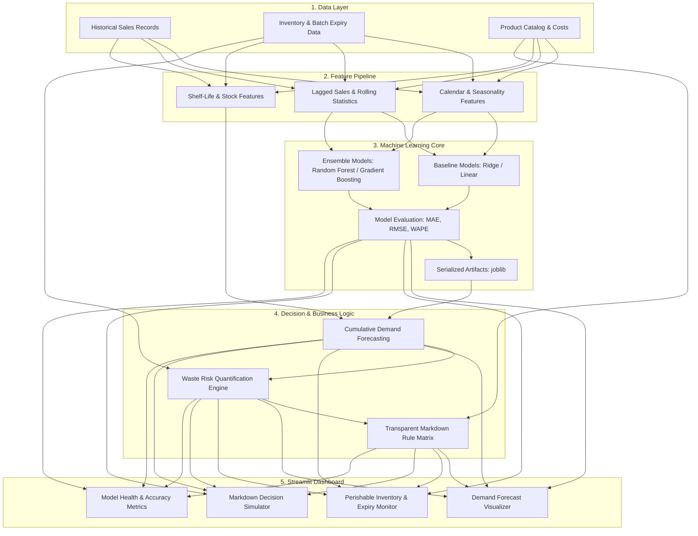

# System Architecture & Technical Design

## 1. Executive Summary

The **AI-Based Retail Food Waste Prediction and Dynamic Markdown Recommendation System** is designed to address a critical operational challenge in perishable food retail: balancing product availability with waste minimization.

The architecture combines:
1. **Machine Learning-Driven Demand Forecasting**: Predicts future daily sales volume using time-series patterns, day-of-week seasonality, and historical demand indicators.
2. **Deterministic Waste Risk Engine**: Quantifies potential unsold inventory by comparing on-hand inventory levels against forecasted demand across the item's remaining shelf-life window.
3. **Transparent Dynamic Markdown Engine**: Applies auditable, rule-based pricing adjustments to stimulate demand before expiration without breaching unit cost floors.
4. **Interactive Streamlit Dashboard**: Provides store managers and analysts with real-time risk alerts, markdown suggestions, and model performance metrics.

---

## 2. High-Level Architecture Diagram

---

## 3. Mathematical Formulation of Waste & Markdown Logic

### 3.1 Waste Risk Formulation
For a given product batch $i$:
- $S_i$: Current on-hand inventory (units).
- $T_i$: Remaining shelf life (days until expiration date).
- $\hat{D}_{i, t}$: Predicted demand for product $i$ on day $t$.
- Cumulative expected demand over remaining shelf life:
$$\hat{D}_{i, [1, T_i]} = \sum_{t=1}^{T_i} \hat{D}_{i, t}$$

- **Estimated Surplus Quantity ($W_i$)**:
$$W_i = \max\left(0, S_i - \hat{D}_{i, [1, T_i]}\right)$$

- **Waste Risk Ratio ($R_i$)**:
$$R_i = \begin{cases} \frac{W_i}{S_i}, & \text{if } S_i > 0 \\ 0, & \text{if } S_i = 0 \end{cases}$$

- **Risk Classification Tiers** (`WasteRiskThresholds`):
  - **LOW**: $R_i \le 0.15$ (Surplus $\le 15\%$ of inventory)
  - **MODERATE**: $0.15 < R_i \le 0.40$ ($15\% < \text{Surplus} \le 40\%$)
  - **HIGH**: $0.40 < R_i \le 0.65$ ($40\% < \text{Surplus} \le 65\%$)
  - **CRITICAL**: $R_i > 0.65$ (Surplus $> 65\%$ of inventory)

### 3.2 Dynamic Markdown Matrix & Margin Floor Safeguard
To maintain full explainability and strict commercial compliance, markdowns are determined via a transparent, auditable decision matrix (`src/markdown_rules.py`):

| Waste Risk Tier ($R_i$) | Proposed Discount ($d$) | Commercial Objective |
| :--- | :---: | :--- |
| **LOW** ($R_i \le 0.15$) | **0% (Full Price)** | Protect regular commercial margins |
| **MODERATE** ($0.15 < R_i \le 0.40$) | **15%** | Mild sell-through acceleration |
| **HIGH** ($0.40 < R_i \le 0.65$) | **30%** | Urgent inventory clearance |
| **CRITICAL** ($R_i > 0.65$) | **50%** | Liquidation before total expiration loss |

**Minimum-Margin Floor Price Safeguard**:
$$\text{Floor Price} = \min\left(\text{Original Price}, \; \text{round}\left(\text{Unit Cost} \times (1 + \text{min\_margin\_pct}), 2\right)\right)$$

**Automatic Tier Downgrading Logic**:
If the proposed discounted price breaches the floor price ($\text{Original Price} \times (1 - d) < \text{Floor Price}$), the engine automatically triggers the margin safeguard and tests available tiers in descending order:
$$d \in (0.50, 0.30, 0.15, 0.00)$$
The system approves the highest discount tier whose discounted price satisfies $\ge \text{Floor Price}$. If no positive discount tier satisfies the floor, the discount is capped at $0\%$ (full regular price).

---

## 4. Why This Hybrid Approach is Defensible in a Viva

1. **Interpretability over Black-Box Pricing**:
   Deep reinforcement learning for retail pricing frequently fails or behaves erratically under out-of-distribution shocks. A hybrid pipeline (Supervised ML for Demand + Rule Engine for Pricing) gives retail managers predictable, auditable control.
2. **Clear Separation of Concerns**:
   - The statistical model handles *uncertainty* (consumer demand).
   - The business rules handle *policy & constraints* (margins, expiration cutoffs, store rules).
3. **Academic Grounding**:
   Aligned with classic revenue management and perishable inventory literature (e.g., dynamic pricing under fixed expiry horizons).

---

## 5. Implemented Module Structure

- `src/preprocessing.py`: Raw CSV validation, perishable category filtering, calendar grid reconciliation (Dec 25 closure fill), holiday integration, leakage-safe shifted lag & rolling feature engineering, and chronological splitting.
- `src/data_quality_report.py`: Reproducible empirical data verification and summary statistics script.
- `src/train.py`: Multi-model pipeline construction (Ridge, Random Forest, HistGradientBoosting), out-of-sample evaluation (MAE, RMSE, WAPE), zero-denominator guards, non-negative clipping, and model persistence.
- `src/waste_risk.py`: Recursive multi-step demand forecasting (zero future leakage buffer), surplus calculation ($W = \max(0, S - \hat{D}_{\text{cum}})$), and risk tier categorization.
- `src/markdown_rules.py`: Dynamic markdown decision matrix, minimum-margin cost floor enforcement, and plain-language explanation generator.
- `app/dashboard.py`: Interactive 4-tab Streamlit application with Plotly visualizations, batch configuration, and viva defense center.
- `docs/viva_guide.md`: Comprehensive undergraduate viva defense guide with 25 examiner Q&As and live demonstration script.

